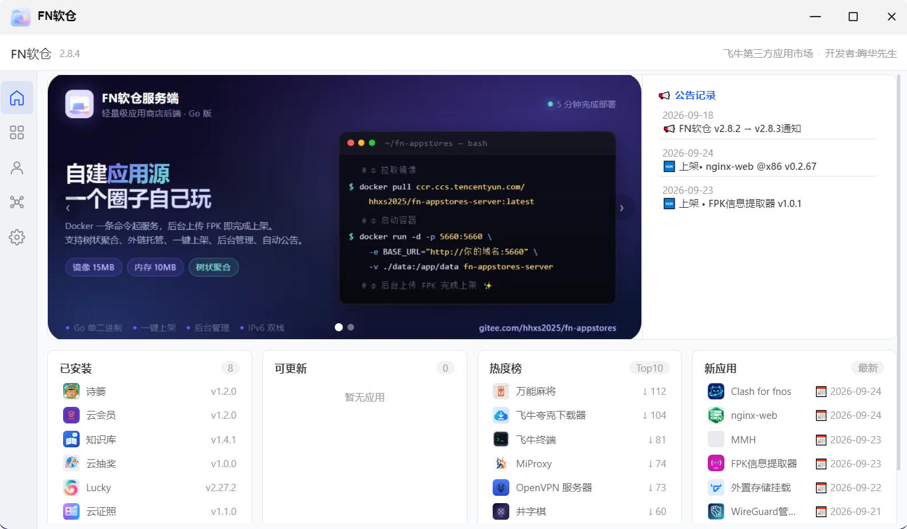
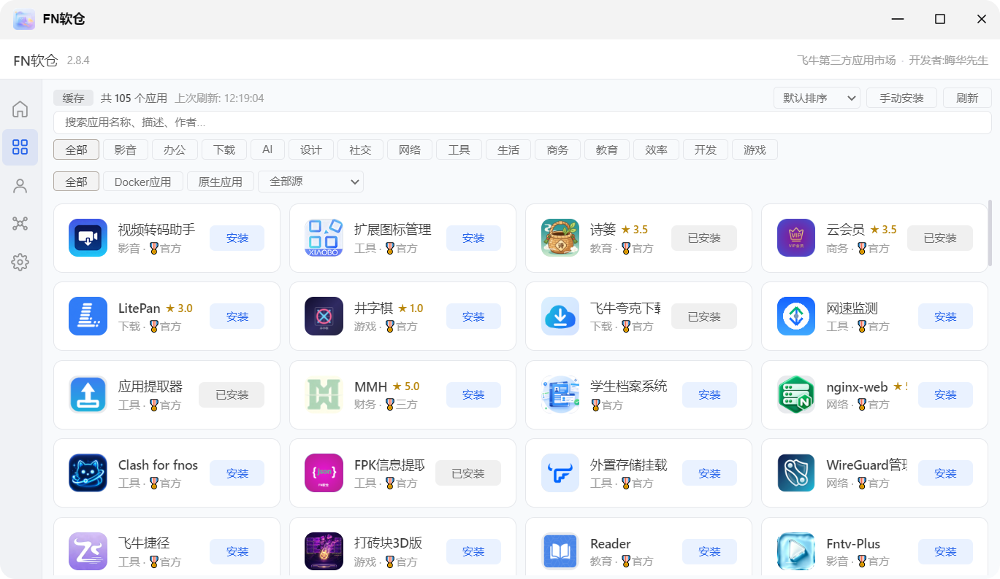
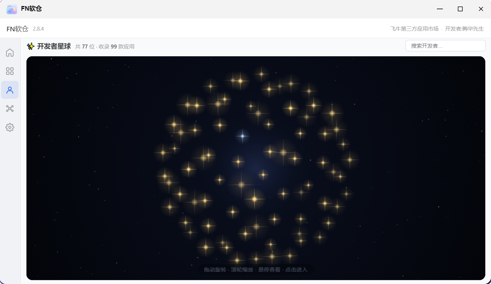

# FN软仓客户端

> 飞牛 OS 第三方应用商店客户端

---

---

## 📖 应用简介

FN软仓是飞牛 OS 上的第三方应用商店客户端，支持**多软件源聚合**。用户可以自由添加自托管服务端地址，浏览、安装、更新飞牛官方应用中心没有的三方应用。

- **项目地址**：[https://gitee.com/hhxs2025/fn-appstores](https://gitee.com/hhxs2025/fn-appstores)
- **服务端镜像**：`docker pull ccr.ccs.tencentyun.com/hhxs2025/fn-appstores-server:2.9.2`
- **平台**：飞牛 OS
- **架构**：x86 / ARM 双架构兼容
- **开源协议**：MIT

> **架构支持说明**：单 fpk 内含 `fn-appstores-client-amd64` 与 `fn-appstores-client-arm64` 双二进制，`cmd/main` 按 `uname -m` 自动选择。安装逻辑已适配用户卷（`/vol*/@appcenter`）与系统分区（`/usr/local/apps/@appcenter`），支持 `install_type = root` 应用。
>
> **微应用支持**：v2.9.0 起声明 `micro_app=true`，可在飞牛应用中心宿主环境内加载，跟随系统主题。

> **✅ v2.9.3 重要改进**：**应用管理与本地回滚 + 全链路前端功能补全**。新增**停止 / 启动 / 重启 / 卸载**应用管理按钮（已安装应用详情页）；新增**升级失败自动回滚**（本地备份 FPK，不依赖服务端保留旧版）；新增**加速器池手动刷新**（设置页一键触发）；新增**静态资源版本号自动管理**（Go 每次请求首页实时计算 JS/CSS 最新修改时间，彻底告别手动改版本号 + 硬刷新）；新增**应用收藏**、**按开发者排序**、**公告未读红点**；使用指南支持移动端。

> **⚠️ v2.9.0 重要提示**：v2.9.0 修复了**应用更新功能从未生效**的历史遗留问题（飞牛官方 CLI 没有 `update` 命令，`install-fpk` 对已安装应用是空操作），并把版本读取源从磁盘 manifest 改为飞牛内部数据库。**v2.8.4 及以前的所有版本，应用更新功能均未真正生效**，请务必升级到此版本或更高版本。

---

## ✨ 核心功能

### 应用管理

- **多源聚合**：从所有启用的软件源并发拉取应用列表，按 `id@platform` 自动去重
- **树状聚合**：官方源可聚合多个三方源应用，无需手动添加即可发现更多应用
- **分类筛选**：15 个固定分类 + Docker/原生类型筛选 + 按源筛选
- **排序**：支持按名称、**开发者**、下载量、更新时间排序（v2.9.3 新增按开发者排序）
- **全局搜索**：侧边栏顶部搜索框，任意页面可直接搜索
- **架构自动适配**：启动时检测本机架构，不兼容的应用自动过滤

### 应用安装与更新

- **应用更新真正生效**：走飞牛 `stop → uninstall → install-fpk` 完整流程，卸载时飞牛自动保留 `@appdata` 用户数据目录，更新前后用户数据零损失
- **版本读取源修复**：从飞牛 `appcenter-cli list`（内部数据库）读实际安装版本，不再依赖可能与数据库不同步的 manifest 文件；辅以 `fixManifestVersion` 在装完后主动同步 manifest，保持数据一致
- **CLI 版本读取缓存**：`appcenter-cli list` 加 5 秒内存缓存，一次安装流程内的 5~6 次读取合并为 1 次；装完后主动 invalidate
- **下载链路打通**：客户端不二次展开候选，服务端下发的候选列表直接用；主源地址永远排第 1，兼顾统计和 302 兜底
- **候选数量与重试次数匹配**：重试次数按候选数动态计算（上限 8，保底 3）
- **失败上报闭环**：客户端上报失败时带 URL，服务端能反查规则并降权
- **手动安装**：支持本地 FPK 上传，显示完整安装日志；支持带向导的 FPK
- **多线路下载**：从服务端获取候选 URL 列表（`download_urls` 数组），依次尝试
- **三层加速兜底**：服务端候选 + 服务端加速器池 + 客户端内置加速器池
- **加速器本地学习**：本地记录每条线路对当前 NAS 的成功/失败次数，按成功率排序
- **主源地址优先**：主源地址在候选列表中永远排第 1，不参与本地学习排序
- **智能切线路**：首块 5 秒速度检测（低于 100KB/s 自动切）+ 30 秒 stall 检测
- **实时进度**：WebSocket 推送下载进度、速度、当前尝试线路等信息
- **完整性校验**：gzip 魔数 + HTML 错误页检测 + hash/size 校验（服务端提供时启用）
- **Docker 应用验证**：容器必须 `running` 才算成功，失败自动清理残留容器
- **依赖缺失引导**：识别飞牛返回的依赖缺失报错，一键跳转飞牛应用中心安装依赖
- **🆕 升级失败自动回滚（v2.9.3）**：每次安装成功后将 FPK 缓存到 `DataDir/rollback/`（每个应用只留最新 1 个）；升级失败时自动卸载新版并重装备份，日志出现 `[rollback] ✅ 回滚成功`
- **客户端自更新**：设置页一键检测最新版本，下载后引导手动安装

### 🆕 应用管理操作（v2.9.3 新增）

- **停止**：`appcenter-cli stop`，停止后应用无法访问，可随时重新启动
- **启动**：`appcenter-cli start`，已运行的应用会直接返回成功
- **重启**：`stop → 轮询等停止（最多 10 秒）→ start`，全程同步阻塞，几秒内返回结果
- **卸载**：`stop → 等停止 → uninstall`，飞牛系统默认保留 `@appdata` 用户数据；操作成功后会顺手清理该应用的回滚备份
- **UI 位置**：仅在**应用详情页**，且**仅对已安装应用**显示 4 个按钮（未安装应用不显示）
- **防重复点击**：操作期间全部按钮 disabled，且按钮文字改为「停止中...」等提示
- **二次确认**：卸载 / 重启 / 停止均有 confirm 二次确认

### 应用评分

- **5 星评分**：详情页内点击星星打分，本地记录"我的评分"
- **评分展示**：应用卡片名称右侧内联显示平均分（★ 4.5）
- **用户身份聚合**：通过统一网关注入的 uid 识别用户，回退到本地 client_id

### 🆕 应用收藏（v2.9.3 新增）

- **一键收藏**：应用卡片右上角 ☆ 或详情页「收藏」按钮
- **本地持久化**：收藏列表存 `localStorage`，不依赖服务端
- **设置页收藏列表**：设置 → 收藏 tab，显示所有收藏应用的图标、名称、作者、版本、安装状态
- **点击跳转**：点收藏项直接跳到应用详情
- **清空收藏**：设置页顶部「清空收藏」按钮（带二次确认）

### 软件源管理

- **添加/删除/启用/禁用**：填写名称和地址，测试连通性后添加
- **状态检测**：源列表显示在线/离线/已禁用，状态缓存 5 分钟
- **官方源保护**：官方源不可删除，地址隐藏显示
- **官方源地址自动迁移**：老用户升级后自动替换内置源地址

### 🆕 加速器池手动刷新（v2.9.3 新增）

- **位置**：设置 → 通用 → 「刷新加速器池」
- **行为**：忽略 24h TTL，删除本地 `accelerators_pool.json` + 清内存缓存，从官方源强制重拉
- **日志**：`[accel-pool] 收到手动刷新请求` + `[accel-pool] ✅ 刷新成功: version=xxx prefixes=N`

### 界面与体验

- **飞牛统一网关**：通过 `/app/fn-appstores-client` 访问，复用飞牛登录态，自动适配 HTTPS
- **系统主题跟随**：
  - 单个「深色模式」开关，逻辑直观
  - 默认自动跟随飞牛系统主题
  - 用户手动切换后进入手动模式，设置页出现「恢复跟随系统」小链接
  - 双通道监听：**2 秒轮询 `getPlatformConfig()` 兜底 + `$on('os/theme')` 事件加速**
- **HTTPS 图片代理**：HTTPS 页面下 HTTP 图片自动走同源代理
- **开发者星球**：3D 球面可视化开发者，拖动旋转、滚轮缩放、悬停查看
- **深色/浅色主题**：一键切换，偏好保存至浏览器
- **🆕 公告未读红点（v2.9.3）**：首页公告列表左侧显示红点，未读项标题加粗，点击查看详情后红点消失；已读状态本地持久化（最多保留最近 500 条）
- **🆕 静态资源自动版本号（v2.9.3）**：改 JS/CSS 保存后 **F5 即生效**，不用重启应用、不用勾 Disable cache、不用手动改 `?v=`
- **🆕 使用指南移动端适配（v2.9.3）**：`static/docs/readme.html` 优化手机端显示，表格横向滚动、目录 chips 横滑、悬浮回到顶部按钮

---

## 🧭 界面介绍

左侧导航栏共 5 项，桌面端 140px 宽，窄屏（≤1100px）折叠为单图标，移动端（≤768px）折叠为汉堡菜单。每项配统一线条 SVG 图标。侧边栏顶部为全局搜索框，输入关键词自动切换到应用页并筛选。

### 🏠 首页

- **顶部轮播图**（占 70%）：平台宣传图，点击可查看大图
- **公告记录**（占 30%）：最近 5 条公告，未读项左侧显示红点，点击查看详情后自动标记已读
- **四列快捷卡片**：已安装 / 可更新 / 热度榜 Top 10 / 新应用
- **点击卡片项**：自动切换到应用页并打开对应详情

---
### 📦 应用

- **工具栏**：状态 + 应用数 + 排序（默认 / 名称 / **开发者** / 下载量 / 更新时间）+ 手动安装 + 刷新
- **分类标签**：15 个固定分类
- **类型/源筛选**：按 Docker / 原生、按来源过滤
- **应用网格**：一次加载全部，无分页
- **应用卡片**：图标 + 名称 + 评分 + 分类·来源 + 安装按钮 + **右上角收藏快捷图标**
- **应用详情**：
  - 主内容区切换，含大图标、元信息栏、更新内容、应用介绍、预览轮播、评分
  - **操作按钮**（v2.9.3）：已安装 → 显示「停止 / 启动 / 重启 / 卸载」；未安装 → 只显示「安装」
  - **收藏按钮**：☆ 收藏 / ★ 已收藏
  - **Issues 反馈**：应用配置了 `repo` 时显示

---
### ✨ 开发者

- 3D 球面可视化开发者，星星大小与应用数挂钩
- 三种配色：金色（官方）、蓝色（认证）、白色（个人）
- 拖动旋转、滚轮缩放、悬停查看；搜索时命中对象高亮
- 窄屏自动降级为卡片列表

---
### 🔗 源管理

- **添加源**：填写名称和地址，可先测试连通性
- **官方源**：地址隐藏显示为 `●●●●●●●`，不可删除
- **三方源**：可启用、禁用、删除

### ⚙️ 设置

- **通用**：
  - **深色模式**开关
  - 手动设置后下方出现「恢复跟随系统」链接
  - 导出日志
  - 清除本地缓存
  - **🆕 刷新加速器池（v2.9.3）**
- **🆕 收藏（v2.9.3）**：收藏应用列表，点击跳详情，可单个取消或清空全部
- **系统**：客户端版本、系统架构、检查更新
- **关于**：开发者、源码仓库、交流群、应用上架、聚合申请、使用指南
- **统计**：总应用数、已安装、可更新、**已收藏**、已配置源
- **建源**：自建源指引、三步部署

---

## 📜 版本记录

### v2.9.3（当前版本）

**应用管理与本地回滚 + 全链路前端功能补全 + 缓存自动管理**

**✨ 新增**

- **应用管理（停止/启动/重启/卸载）**：详情页新增 4 个按钮，仅对已安装应用显示
  - `manage.go` 新建，4 个 handler：`APIStopApp` / `APIStartApp` / `APIRestartApp` / `APIUninstallApp`
  - 重启 = `stop → 轮询等停止（最多 10s）→ start`
  - 卸载 = `stop → 等停止 → uninstall`，成功后清该应用的回滚备份
- **本地回滚**：`rollback.go` 新建
  - 每次安装成功后将 FPK 缓存到 `DataDir/rollback/{appID}-{version}.fpk`（每个应用只留最新 1 个）
  - 升级失败时 `tryRollback` 自动卸载新版 + 重装备份
  - 前端提示："新版安装失败，已自动回滚到 vX.X.X"
  - **不依赖服务端保留旧版**，外链场景也能用
- **加速池手动刷新**：`accel_pool.go` 新增 `forceRefreshAccelPool` + `APIRefreshAccelPool`
  - 忽略 24h TTL，删除本地缓存 + 清内存后强制重拉
  - 设置页新增「刷新加速器池」按钮
- **静态资源自动版本号**：`main.go` 新增 `calcStaticVersion()`
  - 每次请求首页扫描 `static/js` / `static/css` 最新 mtime
  - 通过 `StaticVer` 注入到 `index.html` 的 `<script src="...?v={{.StaticVer}}">`
  - **改 JS/CSS 保存后 F5 即生效**，不用重启、不用硬刷新、不用手动改 `?v=`
- **应用收藏**：`core.js` 新增 `getFavorites` / `isFavorite` / `toggleFavorite` / `getFavoriteApps`
  - 卡片右上角 ☆ / 详情页「收藏」按钮
  - 设置页新增「收藏」tab
  - 本地 `localStorage` 持久化
- **按开发者排序**：`apps.js` `sortApps` 加 `case 'author'`
  - 按作者名（不区分大小写）升序，同作者内按名称
  - 空作者排最后
- **公告未读红点**：`home.js` 新增 `noticeRecordId` / `isNoticeRead` / `markNoticeRead`
  - 首页公告未读项左侧显示红色脉冲圆点，标题加粗
  - 点击查看详情后自动标记已读
  - 本地持久化，最多保留 500 条
- **使用指南移动端适配**：`static/docs/readme.html` 重构 CSS
  - 表格用 `.table-wrap` 包裹，窄屏横向滚动
  - 目录改为 chips 横向滑动
  - 新增悬浮「回到顶部」按钮
  - 深色模式跟随 `prefers-color-scheme`
- **`appcenter-cli` 版本检测**：启动时检查必需命令（`install-fpk` / `list` / `uninstall` / `start` / `stop`），日志以 `[v2.9.3]` 前缀打印
- **安装结果版本兜底**：`checkInstallResultWithVersion` 关键词匹配失败时，用实际版本 vs 期望版本比对，避免假成功

**🐛 修复**

- **修复应用详情页收藏按钮点击无反应**：`toggleDetailFavorite` / `toggleCardFavorite` / `renderFavorites` / `toggleFavorite` 等全部显式 `window.xxx = xxx`
- **修复浏览器强缓存导致 JS 更新后仍用旧文件**：`gateway.go` 加 `noCacheStatic` 设置 `Cache-Control: no-cache, must-revalidate`；`index.html` 加 `?v={{.StaticVer}}` 双保险
- **修复 `.detail-actions .btn-fav.active` 未生效**：CSS 变量作用域修正

**🔧 内部改动**

- 新建 `manage.go`、`rollback.go`
- `gateway.go` 加 5 条路由：`/api/app/:app_id/{stop,start,restart,uninstall}`、`/api/accel-pool/refresh`
- `accel_pool.go` 拆出 `doFetchAccelPool`，`refreshAccelPool` 和 `forceRefreshAccelPool` 共用
- `install.go` `installAndReport` 成功时调 `saveRollbackFPK`，失败时调 `tryRollback`
- `install.go` 末尾新增 `tryRollback`
- `main.go` 加 `calcStaticVersion` + `IndexPage` 传 `StaticVer`

**🔌 兼容性**

- **服务端 v2.9.2 配套最佳**
- **v2.9.2 客户端**：完全兼容，可平替升级
- **服务端 v2.8.x**：新接口不可用时自动回退

### v2.9.2

**下载链路打通 + 学习闭环激活 + 主源候选修复**

**🐛 修复**

- **修复主源半托管 / fnrc 聚合源只有 1 条候选**：客户端不再二次展开候选，直接使用服务端下发的完整列表
- **修复失败上报空转**：客户端上报失败时带上 `url`，服务端能反查规则并降权
- **修复候选与重试次数不匹配**：`maxDownloadRetries` 按 `len(candidates)` 动态计算（上限 8，保底 3）
- **修复服务端 health check 排序失效**：`buildAllCandidates` 服务端已给候选时直接 return

**✨ 新增**

- **主源地址优先排序**：新增 `isPrimarySourceURL`，`sortByAccelHistory` 让主源地址永远排第 1

### v2.9.1

**主题系统重构 + CLI 缓存 + 向导装后刷新**

**🎨 主题系统重构**

- 合并为单个「深色模式」开关
- 双通道监听：2 秒轮询 + `$on` 事件加速
- 修复"系统主题切换后页面只变顶部"

**⚡ 性能优化**

- CLI 版本读取 5 秒缓存
- 手动安装成功后刷新应用状态

### v2.9.0

**应用更新功能修复 + 三层加速兜底 + 版本读取源重构**

**🐛 修复**

- **修复应用更新功能从未生效（重大问题）**：`stop → uninstall → install-fpk` 完整流程
- **修复"更新完还显示可更新"**：版本读取从 manifest 改为 `appcenter-cli list`
- **修复手动安装对带向导应用失败**

**✨ 新增**

- **三层加速兜底**、**加速器本地学习**、**智能切线路**
- **加速器池自动更新**、**依赖缺失引导**、**系统主题跟随**、**微应用声明**

### v2.8.4 及以前

**⚠️ 已知问题**：v2.8.4 及以前的所有版本，**应用更新功能均未真正生效**（`install-fpk` 对已安装应用是空操作），UI 显示"更新成功"但实际版本未变。**此问题在 v2.9.0 修复**。

**主要历史节点**：

- **v2.8.4**：修复 ARM 安装失败、`install_type=root` 兼容、新增手动安装入口、x86/ARM 双架构单包
- **v2.8.3**：纯 UI 改版，应用卡片精简 + 详情页改版 + 侧边栏全局搜索 + 取消分页
- **v2.8.2**：官方源地址迁移 + Docker 应用安装结果验证 + 安装失败自动清理
- **v2.8.0**：新增应用评分系统 + 架构自动检测 + 骨架屏
- **v2.7.0**：后端从 Python 迁移到 Go + Gin，新增开发者星球
- **v2.6.x**：接入飞牛统一网关，WebSocket 统一管理，断线重连
- **v2.5.x 及以前**：基础框架搭建，多源聚合

> 更早版本的详细变更已合并至 [Gitee 提交记录](https://gitee.com/hhxs2025/fn-appstores-client/commits/master) 查询。

---

## 🖥️ 服务端信息

客户端需要配合 **FN软仓服务端** 使用，服务端负责聚合应用列表、下发候选下载地址、维护加速器规则、公告和轮播图。

- **服务端镜像**：`docker pull ccr.ccs.tencentyun.com/hhxs2025/fn-appstores-server:2.9.2`
- **服务端仓库**：[https://gitee.com/hhxs2025/fn-appstores](https://gitee.com/hhxs2025/fn-appstores)

服务端 v2.9.2（配套客户端 v2.9.3）的核心能力：

- **候选 URL 列表下放**：`/api/apps` 与 `/api/app/:id` 返回 `download_urls` 数组（主源 + 5 条加速器 + 原始兜底）
- **主源半托管 / fnrc 聚合源候选展开**：`buildDownloadCandidates` 会为主源半托管和 fnrc 聚合源展开加速器候选
- **302 优先 online**：`applyAccelerator` 两轮遍历，优先落 online 线路，degraded 兜底
- **加速器健康检查**：5 秒探测窗口 + 100KB/s 阈值，分 online / degraded 两档
- **失败上报接收**：`/api/accelerator/report-failed` 接收客户端上报，动态调整规则
- **仪表盘分栏**：本地源 / 聚合源分开统计
- **开发者聚合系统**：`fnrc.json` 三层生态，第三方开发者零服务器成本接入

---

## 👨‍💻 开发者信息

| 项目 | 信息 |
| :--- | :--- |
| **开发者** | 晦华先生 |
| **联系方式** | 2303537063@qq.com |
| **开源地址** | [https://gitee.com/hhxs2025/fn-appstores](https://gitee.com/hhxs2025/fn-appstores) |
| **交流群** | 2154077576 |
